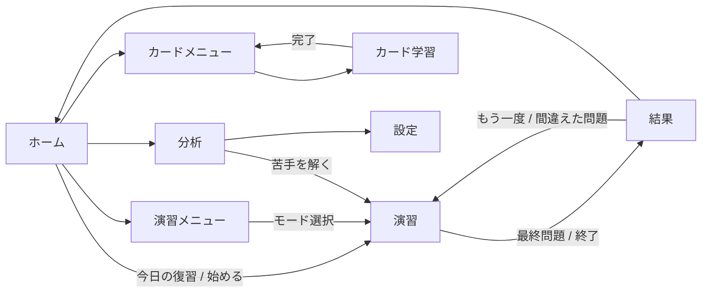

# 設計書 — 基本情報ドリル

最終更新: 2026-10-24 / 版: 1.0
前提: [01-requirements.md](01-requirements.md)、[02-wbs-estimate.md](02-wbs-estimate.md)

## 1. 採用デザイン

| 項目 | 採用 |
|---|---|
| ダークテーマ | 案B「夜の単語帳」 |
| ライトテーマ | 案B2「昼の単語帳」 |
| 演習・用語カード | 案B3「集中モード」（1問1画面、解説は下から出るパネル、カードはスワイプで仕分け） |
| ホーム・分析 | 案B／B2 のレイアウト |
| フォント | IBM Plex Sans JP（本文）＋ IBM Plex Mono（数字・コード） |
| 下部タブ | ホーム／演習／カード／分析（案B）。演習中・カード学習中はタブを隠す |

デザインの原本は Design キャンバス（design/project/*.dc.html）。配色・文字サイズは [src/styles/tokens.css](../src/styles/tokens.css) のCSS変数だけを使う。

## 2. 技術構成

| 区分 | 採用 | 理由 |
|---|---|---|
| UI | Preact 10 ＋ TypeScript 6 | 軽量（初回表示3秒以内の要件）。Preact 11 は出たばかりなので見送り |
| 状態管理 | @preact/signals | 画面をまたぐ学習記録を少ないコードで共有できる |
| ルーティング | 自前のハッシュルーター（`#/stats` 形式） | GitHub Pages で直接URLを開いても 404 にならない |
| ビルド | Vite 8 | |
| PWA | vite-plugin-pwa（generateSW、更新は「更新があります」で確認してから） | 要件F7 |
| データ検証 | zod 4 | 問題JSONのスキーマ検証（要件F2-1） |
| 同期 | Firebase Authentication（Google）＋ Cloud Firestore | 要件F6 |
| フォント | @fontsource（自前配信）。初回利用時にキャッシュ | 外部CDNに頼らずオフラインでも表示 |
| テスト | Vitest ＋ jsdom ＋ @testing-library/preact。画面確認は内蔵ブラウザ | |

## 3. 画面一覧と遷移

| ID | 画面 | URL | タブ | 元デザイン |
|---|---|---|---|---|
| S01 | ホーム | `#/` | 表示 | B-Home / B2-Home |
| S02 | 演習メニュー | `#/practice` | 表示 | B-Home のクイックスタート部分を独立 |
| S03 | 演習（集中モード） | `#/session` | 非表示 | B3-Quiz |
| S04 | 結果 | `#/result` | 非表示 | 新規（B系のトーン） |
| S05 | カードメニュー | `#/cards` | 表示 | B-Cards の絞り込み部分 |
| S06 | カード学習（集中モード） | `#/cards/session` | 非表示 | B3-Cards |
| S07 | 分析・学習計画 | `#/stats` | 表示 | B-Stats / B2-Stats |
| S08 | 設定 | `#/settings` | 表示（分析から遷移） | 新規 |



### 3.1 演習モード

| モード | 出題 | 制限時間 | 解答直後の解説 |
|---|---|---|---|
| 今日の復習 | 期限が来た問題（最大20問）＋ 足りなければ未出題 | なし | あり |
| ランダム10問 | 科目A全体から10問 | なし | あり |
| 分野別 | 指定した大分類・中分類から10問 | なし | あり |
| 弱点 | 正答率の低い中分類から10問 | なし | あり |
| 基数変換ドリル | 自動生成10問 | なし | あり |
| ミニ模試 | 科目A 20問 | 30分 | なし（終了後にまとめて） |
| 科目A 本番形式 | 科目A 60問（分野比率：テクノロジ約7割） | 90分 | なし |
| 科目B 本番形式 | 科目B 20問（アルゴリズム16＋セキュリティ4） | 100分 | なし |

模試は途中で閉じても再開できる（セッションを保存）。

### 3.2 集中モード（B3）の操作仕様

- 演習：選択肢をタップで即解答。解説は画面下からパネルで出る（高さは画面の約55%、上に解説、下に「誤りを報告」と「次へ」）
- パネルを上にスワイプ、または「次へ」で次の問題。移動量 80px 以上でスワイプと判定
- カード：表をタップでめくる。左スワイプ＝まだ、右スワイプ＝覚えた（移動量 100px 以上）。下の「まだ」「覚えた」ボタンでも同じ操作
- キーボード：1〜4で解答、Enter／Spaceで次へ・めくる、←→でまだ／覚えた
- `prefers-reduced-motion` のときはアニメーションを使わずに切り替える

## 4. データ設計

型の正本は [src/types/index.ts](../src/types/index.ts)、検証スキーマは [src/data/schema.ts](../src/data/schema.ts)。

### 4.1 問題（data/questions/*.json）

1ファイル = 問題の配列。ファイル名は `a-tech-<中分類>.json`、`a-mgmt-*.json`、`a-strat-*.json`、`b-algo-*.json`、`b-sec-*.json`、`ipa-<年度>.json`。

| 項目 | 型 | 説明 |
|---|---|---|
| id | string | 一意。`a-tech-net-001` のように「ファイル接頭辞-連番」 |
| exam | "A" \| "B" | 科目 |
| field | Field | tech / mgmt / strat（科目A）、algo / sec（科目B） |
| major | string | シラバス大分類（例：コンピュータシステム） |
| minor | string | シラバス中分類（例：ネットワーク）。§4.5 の一覧から選ぶ |
| difficulty | 1 \| 2 \| 3 | 1=基本、2=標準、3=応用 |
| stem | string | 問題文。改行は `\n` |
| code | string? | 擬似言語などのコード（等幅で表示） |
| choices | string[4] | 選択肢（ア〜エの順） |
| answer | 0〜3 | 正解の添字 |
| explanation | string | 解説。誤答の選択肢がなぜ違うかも書く |
| shuffle | boolean? | 既定 true。「ア〜ウのすべて」のように順序に意味がある問題は false |
| source | Source | `{ "type": "original" }` または `{ "type": "ipa", "title": "令和5年度 科目A 公開問題", "number": "問3", "url": "https://..." }` |

科目Bで選択肢が5つ以上ある問題（ア〜カ等）は `choices` を最大8件まで許す。

### 4.2 用語（data/terms/*.json）

| 項目 | 型 | 説明 |
|---|---|---|
| id | string | `term-mtbf` のような一意ID |
| term | string | 用語 |
| reading | string? | 読み（英字略語の読みなど） |
| meaning | string | 意味（2〜3文）。公式があれば含める |
| field | "tech" \| "mgmt" \| "strat" | |
| minor | string | 中分類 |

### 4.3 学習記録（端末内 localStorage ＋ Firestore）

| 種類 | キー | 内容 |
|---|---|---|
| 項目ごとの記録 ItemProgress | 問題ID / 用語ID | 出題回数・正解数・間隔反復の状態（reps, ease, interval, due）・最終結果・updatedAt |
| 日ごとの記録 DayLog | `YYYY-MM-DD` | 回答数・正解数・カード枚数・updatedAt |
| 設定 Settings | 1件 | テーマ・試験日・1日の目標・updatedAt |
| 中断中の模試 SavedSession | 1件 | 出題順・回答・残り時間 |

localStorage のキーは `fe-drill:v1:<種類>`。容量の目安：700項目 × 約150バイト ≒ 100KB。

### 4.4 間隔反復（SM-2 を簡略化）

| 結果 | 更新 |
|---|---|
| 正解／覚えた | reps += 1。interval = reps=1 なら 1日、reps=2 なら 3日、以降 round(interval × ease)。ease = min(2.8, ease + 0.1) |
| 不正解／まだ | reps = 0、interval = 0（同じ日のうちにもう一度）、ease = max(1.3, ease − 0.2)、lapses += 1 |

- 初期値：ease 2.5、reps 0、interval 0
- due = 今日 + interval 日。日付は端末のローカル日付（`YYYY-MM-DD`）で扱う
- 「今日の復習」= due ≦ 今日 の項目を、due の古い順に出す

### 4.5 中分類（シラバスに準拠）

| field | 大分類 | 中分類 |
|---|---|---|
| tech | 基礎理論 | 基礎理論、アルゴリズムとプログラミング |
| tech | コンピュータシステム | コンピュータ構成要素、システム構成要素、ソフトウェア、ハードウェア |
| tech | 技術要素 | ユーザーインタフェース、情報メディア、データベース、ネットワーク、セキュリティ |
| tech | 開発技術 | システム開発技術、ソフトウェア開発管理技術 |
| mgmt | プロジェクトマネジメント | プロジェクトマネジメント |
| mgmt | サービスマネジメント | サービスマネジメント、システム監査 |
| strat | システム戦略 | システム戦略、システム企画 |
| strat | 経営戦略 | 経営戦略マネジメント、技術戦略マネジメント、ビジネスインダストリ |
| strat | 企業と法務 | 企業活動、法務 |
| algo | 科目B | アルゴリズムとプログラミング |
| sec | 科目B | 情報セキュリティ |

### 4.6 Firestore の構造と同期

```
users/{uid}/progress/{itemId}   ItemProgress
users/{uid}/days/{YYYY-MM-DD}   DayLog
users/{uid}/meta/settings       Settings
```

- 端末内の記録が正本。変更はキューに積み、オンライン時に書き込む（Firestore のオフライン永続化を使う）
- ログイン直後に全件を取得し、同じキーは updatedAt が新しい方を採用（項目単位の後勝ち）
- Firebase の設定値は `src/sync/firebase-config.ts` に置く。空のままなら同期機能を隠し、ローカルだけで動く
- セキュリティルール：`request.auth.uid == uid` のときだけ `users/{uid}/**` を読み書きできる（[firestore.rules](../firestore.rules)）

## 5. 分析と学習計画の計算

| 指標 | 計算 |
|---|---|
| 正答率 | 正解数 ÷ 回答数（すべての回答を数える） |
| 分野別正答率 | field ごとに集計。合格目安の線は 60% |
| 苦手トップ5 | 回答5回以上の中分類のうち正答率の低い順 |
| 予想正答率 | 直近200回答の正答率（未回答の分野は含めない） |
| 残り日数 | 試験日 − 今日 |
| 1日の目標の提案 | max(10, ceil(未出題問題数 ÷ 残り日数) ＋ 今日の復習数) |
| 連続学習日数 | 今日（または昨日）から遡って回答1件以上の日が続いた日数 |

## 6. モジュール構成と並列製造の担当

```
src/
  main.tsx, app.tsx           アプリの起点、ルーター、タブ           ── A
  router.ts                   ハッシュルーター                       ── A
  ui/                         共通部品（Button, BottomSheet, TabBar…）── A
  features/home|practice|session|result|cards|stats|settings/      ── A
  types/index.ts              ドメイン型（契約）                     ── 設計で確定
  styles/tokens.css, base.css デザイントークン（契約）               ── 設計で確定
  data/schema.ts              zod スキーマ（契約）                   ── 設計で確定
  data/loader.ts              問題・用語の読み込み                   ── B
  core/srs.ts                 間隔反復                               ── B
  core/select.ts              出題の選び方（モード別）               ── B
  core/stats.ts               分析・学習計画の計算                   ── B
  core/radix.ts               基数変換問題の自動生成                 ── B
  core/dates.ts               ローカル日付の扱い                     ── B
  store/                      signals と localStorage の永続化        ── B
  sync/                       Firebase 認証・同期                    ── B
data/questions/a-tech-*.json  科目A テクノロジ系 約180問             ── C
data/questions/a-mgmt-*.json, a-strat-*.json  約120問                ── D
data/questions/b-*.json, data/terms/*.json  科目B 40問・用語300語    ── E
data/questions/ipa-*.json     IPA公開問題                            ── F
tests/                        各担当が自分のモジュールのテストを書く
```

### 6.1 A と B の取り決め（B が実装し、A が使う関数）

A は B の完成を待たずに作れるよう、次の名前と型で呼び出す。B はこの通りに公開する。

```ts
// data/loader.ts
loadQuestions(): Promise<Question[]>
loadTerms(): Promise<Term[]>

// core/select.ts
buildSession(mode: SessionMode, ctx: SelectContext): SessionItem[]

// core/srs.ts
review(prev: ItemProgress | undefined, result: ReviewResult, today: string, item: { id: string; kind: ItemKind }): ItemProgress

// core/stats.ts
summarize(ctx: StatsContext): StatsSummary

// core/dates.ts
todayLocal(now?: Date): string; addDays(date: string, days: number): string; diffDays(from: string, to: string): number

// core/radix.ts
generateRadixQuestions(count: number, seed?: number): Question[]

// store/index.ts（signals）
progress: Signal<Record<string, ItemProgress>>
days: Signal<Record<string, DayLog>>
settings: Signal<Settings>
recordAnswer(item: { id: string; kind: ItemKind }, correct: boolean): void
updateSettings(patch: Partial<Settings>): void
savedSession: Signal<SavedSession | null>

// sync/index.ts
syncAvailable: boolean
authUser: Signal<AuthUser | null>
signIn(): Promise<void>
signOut(): Promise<void>
```

型（SessionMode, SelectContext, SessionItem, ReviewResult, StatsContext, StatsSummary, AuthUser など）はすべて src/types/index.ts に定義済み。

## 7. テスト方針

| 種類 | 対象 | 担当 |
|---|---|---|
| 単体 | srs、select、stats、radix、dates、同期の後勝ちマージ | B |
| データ検証 | 全JSONをスキーマ検証、ID重複、正解の添字、選択肢の重複、解説の有無 | 統合時（tests/data） |
| 内容レビュー | 各問題ファイルから抜き取りで正誤を別エージェントが確認 | テスト工程 |
| 画面 | 主要導線（ホーム→演習→結果、カード、分析、テーマ切替）、スマホ幅、オフライン | テスト工程（内蔵ブラウザ） |

## 8. デプロイ

- GitHub リポジトリ `fe-drill`（Public）、GitHub Actions で main への push 時に `BASE_PATH=/fe-drill/ npm run build` して Pages に公開
- Firebase の設定値はクライアント用の公開値なのでリポジトリに置いてよい。ただし Firestore ルールで本人以外のアクセスを防ぐ
- 手順書：docs/05-firebase-setup.md（エージェントBが作成）
